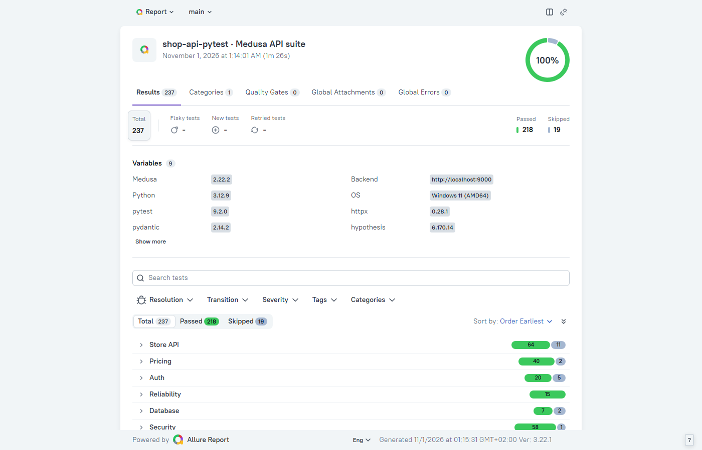
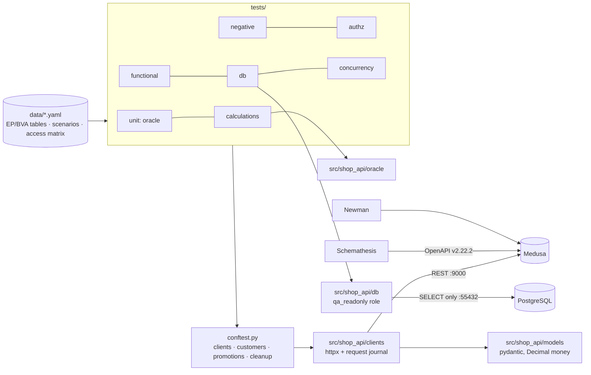

# Shop API · pytest + httpx

A deep API test suite for **Medusa**, an open-source commerce platform: an independent pricing oracle
for discounts and taxes, an access-control matrix, OpenAPI contract fuzzing, database and concurrency
checks — in Python with pytest, httpx and pydantic.

    

## In 30 seconds

- **237 tests**, 218 passing and 19 strict expected failures that pin **10 real Medusa defects**; full run in
  ~85 s in parallel (164 s sequential), stable over 8 consecutive parallel runs and random orders (2026-11-01).
- **Pricing oracle:** discount and tax maths re-implemented with `Decimal` from Medusa's docs; **40 scenarios**
  (percentage, fixed, buy X get Y, thresholds, stacking, tax-inclusive) match the API to 1e-9, including the
  documentation's own examples. It also showed that Medusa charges sub-cent amounts (35.4745 EUR).
- **Access matrix:** 4 roles × 15 operations = 58 cases from YAML, separating Medusa's documented
  "ID as capability" design from a real cart-takeover BOLA.
- **Contract fuzzing:** Schemathesis on the pinned OpenAPI spec, 258 failures triaged (0 unclassified), three
  new 5xx defects found; Postman collection run by Newman.

## Live reports

Allure on GitHub Pages arrives with publication (see Roadmap). Locally: `make report` →
`allure-report/index.html` (screenshot below from a real run).



## Architecture



## Stack

| Tool | Why |
|---|---|
| pytest 9.2, pytest-xdist, pytest-randomly | Fixtures, parametrisation from tables, parallel and random-order runs ([ADR-001](docs/adr/ADR-001-pytest-httpx-pydantic.md)) |
| httpx 0.28 | Timeouts, event hooks for a masked request journal attached to failures |
| pydantic 2.14 + pydantic-settings | Response models with `Decimal` money; settings validated from the contract file |
| Hypothesis 6.170 | Property tests of the pricing oracle |
| Schemathesis 4.32 | OpenAPI-driven fuzzing with triaged baselines |
| psycopg 3 | Read-only SQL checks |
| Allure Report 3.22 | Steps, categories, environment, trend without a JVM ([ADR-002](docs/adr/ADR-002-allure-3.md)) |
| Postman + Newman 6.2 | Smoke collection for teams that live in Postman |
| uv, ruff, mypy `--strict`, pre-commit | Locked dependencies and clean code |

## Quick start

Prerequisites: Python ≥ 3.12, [uv](https://docs.astral.sh/uv/), Node.js ≥ 22 (Newman/Allure), Docker with
Compose v2, GNU Make. macOS: `brew install uv node`.

```bash
make -C ../shop-sut up && make -C ../shop-sut smoke   # the stand, from the sibling repository
uv sync --frozen
make smoke              # 4 checks
make test               # full suite in parallel
make contract           # Schemathesis against the triaged baselines
make newman             # Postman collection
make report             # Allure report in allure-report/
```

The contract file `../shop-sut/.generated/sut.env` provides every URL, key and ID; set `SUT_ENV_FILE` to
use another one. `make docker-test` runs the suite in a container on the stand's network.

## Project structure

| Path | Purpose |
|---|---|
| `src/shop_api/clients/` | httpx clients for Store, Auth and Admin; masked request journal |
| `src/shop_api/models/` | pydantic response models |
| `src/shop_api/oracle/` | Independent pricing oracle and rounding policy |
| `src/shop_api/db/` | All SQL of the suite, read-only |
| `src/shop_api/jwt.py` | Builds expired, re-signed and `alg: none` tokens for negative tests |
| `tests/<marker>/` | Suites: unit, smoke, functional, negative, calculations, authz, db, concurrency |
| `data/` | YAML tables: negative EP/BVA cases, pricing scenarios, access matrix |
| `contracts/` | Pinned OpenAPI specs (with SHA-256) and Schemathesis baselines |
| `postman/` | Collection, environment template, Newman runner |
| `scripts/` | Triage of contract failures, access-matrix document, API coverage |
| `docs/` | Strategy, pricing rules, findings, contract findings, matrix, coverage, ADRs |

## Test strategy

Risk-first: money (oracle), data exposure (matrix), integrity (database, concurrency), robustness
(negative tables, fuzzing). Shared data is read-only; each test creates and deletes what it changes.
Full version: [docs/test-strategy.md](docs/test-strategy.md).

## Coverage

| Area | Tests |
|---|---|
| Pricing: percentage, fixed, across/each/once, buy X get Y, thresholds (BVA), stacking, currencies, taxes (exclusive/inclusive) | 40 scenarios + 1 money-precision test + 22 oracle tests |
| Catalog: pagination (BVA), fields, filters, sorting, regions | 20 |
| Customer, addresses, checkout, order history, stock reservation | 10 |
| Input validation (EP/BVA tables), tokens (expired, forged, `alg: none`) | 58 |
| Access matrix incl. BOLA | 58 + 1 self-check |
| Database state | 8 |
| Concurrency | 15 |
| API operations exercised | Store 28/78 by tests + 48 fuzzed; Admin 18/413 ([docs/api-coverage.md](docs/api-coverage.md)) |

## CI/CD

Planned with publication: PR — ruff, mypy, then smoke, functional and negative in parallel, oracle unit
tests and Newman; nightly — full suite including calculations, matrix, database, concurrency and the
extended Schemathesis run, Allure with history on GitHub Pages; a job against the next Medusa version.

## How-to

| Task | Command |
|---|---|
| One test | `uv run pytest tests/calculations -k fixed-10-uneven-split` |
| By marker | `uv run pytest -m "authz or db" -n auto` |
| Debug a failure | `uv run pytest <nodeid> -x -vv -p no:randomly`; the Allure attachment shows the last 20 HTTP exchanges |
| Add a pricing scenario | Add a line to `data/calculations/scenarios.yaml` — the oracle computes the expectation |
| Add a negative case | Add a row to `data/negative/*.yaml` with the technique and expected error |
| Accept a triaged contract failure | Classify it in `docs/contract-findings.md`, then `make contract-update` |
| Regenerate docs | `uv run python scripts/authz_matrix_doc.py`, `make coverage` |

## Results and findings

[docs/findings.md](docs/findings.md) (product defects) · [docs/contract-findings.md](docs/contract-findings.md)
(spec defects) · [docs/authz-matrix.md](docs/authz-matrix.md) · [docs/pricing-rules.md](docs/pricing-rules.md)

| ID | Finding | Severity |
|---|---|---|
| BUG-API-006 | Money is not rounded to minor units: payment collection of 35.4745 EUR | Major |
| BUG-API-005 | `quantity: 1.5` is accepted and charged as 2 units | Minor |
| BUG-API-010 | A customer can take over another registered customer's cart (BOLA) | Minor |
| BUG-API-007 | Query parameter `a.b.c=1` → 500 on every list endpoint | Minor |
| BUG-API-008 | Invalid date filter → 500 | Minor |
| BUG-API-004 | Promotions / line-item delete on an unknown cart → 500 instead of 404 | Minor |
| BUG-API-001…003, 009 | Negative pagination → 500; registration validation; delete of a missing item reports success | Minor–Trivial |
| SPEC-0…7 | Seven classes of OpenAPI spec defects (nullable fields, documented-but-rejected parameters, …) | — |

## Decisions

- [ADR-001](docs/adr/ADR-001-pytest-httpx-pydantic.md) — pytest + httpx + pydantic over requests, Tavern, Robot Framework, Karate
- [ADR-002](docs/adr/ADR-002-allure-3.md) — Allure Report 3 over Allure 2

## How AI was used

The owner defined the goals and scope and approved the strategy and tools. An AI coding assistant
(Claude Code) wrote most of the code and documentation within that plan; every number here comes from
real runs against the stand, and every finding was reproduced by hand. Details: [docs/ai-usage.md](docs/ai-usage.md).

## Roadmap & known limitations

- CI on GitHub Actions and Allure with history on Pages (needs the GitHub repository).
- Admin API coverage is intentionally thin (18/413); extend with promotions and price lists.
- Schemathesis baselines depend on data in the stand; the triage procedure handles it (see contract-findings).
- Verified on Windows 11 x86_64; macOS arm64 and Linux runs pending.
- Findings are not yet filed upstream with Medusa.

## Licence and credits

MIT © 2026 Taras Bilokin — [LICENSE](LICENSE). OpenAPI specs in `contracts/openapi/` are Medusa's (MIT), tag v2.22.2.
Built with pytest, httpx, pydantic, Hypothesis, Schemathesis (MIT), Allure Report (Apache-2.0), Newman (Apache-2.0).
